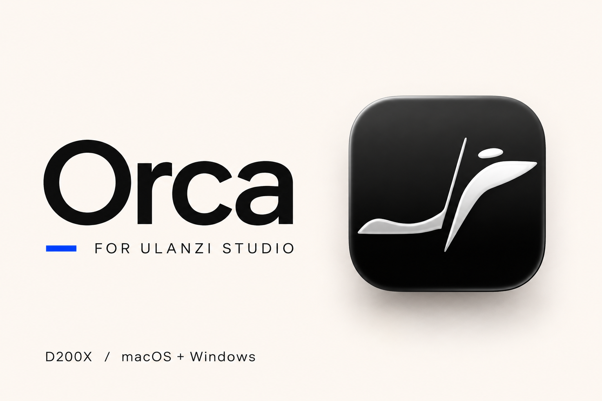

# Orca for Ulanzi Studio

[English](README.md) · [한국어](README.ko-KR.md) · [简体中文](README.zh-CN.md) · [日本語](README.ja-JP.md)

**AMOSA** が独立して開発する Ulanzi Creative Deck D200X 用プラグインです。ボタンとノブで Orca を操作できます。バージョン **0.0.1** は Ulanzi マーケットで審査中です。



## 機能

- Orca の起動、前後のワークツリーと全種類のタブへの移動
- 左右サイドバーの切り替え、Enter、Escape、音声入力、新規エージェントタブ（macOS のみ）
- ワークツリー移動、全タブ移動、マウスホイール用ノブ
- 英語・韓国語・簡体字中国語・日本語のインターフェース

Enter はメッセージを送信する場合があります。Enter／Escape は現在のフォーカスに作用し、承認リクエストを自動識別しません。スクロールはマウスポインターの位置に作用します。

## 対応環境

| 項目 | 対応範囲 |
|---|---|
| 機器 | Creative Deck D200X |
| OS | macOS（Apple Silicon）、Windows 10 以降 |
| 確認済み環境 | macOS 27.0.1 / Orca 1.4.258 / Ulanzi Studio 3.4.8 / D200X |
| Windows | 初期対応、モックテスト通過、実機未検証 |

Intel Mac のマウスホイールと Linux は非対応です。Windows では各アクションの設定に、インストール済み Orca CLI の絶対パス（`index.js` または `.exe`）を指定してください。変更した Orca のショートカットは自動検出しません。新規エージェントタブは macOS 専用です。

## インストール

先に [Orca](https://github.com/stablyai/orca) と Ulanzi Studio をインストールし、下記のコマンドで配布ファイルを生成してください。

1. Studio で `dist/com.ulanzi.orcanavigation.ulanziPlugin.zip` をインストールします。
2. 「環境設定 → プリセット → インポート」で `dist/Orca-D200X-macOS-0.0.1.ulanziDeckProfile` を選択します。プリセットは別途インポートが必要です。
3. 必要に応じてプリセットと Orca アプリの関連付けを手動で設定します。
4. インストール・更新後は Studio を完全に終了して再起動します。起動中にファイルだけを置き換えると、古いコードが残り、警告アイコンが表示される場合があります。

付属プリセットは macOS 向けの配置です。[配置とインポートの説明](presets/README.md)（韓国語）を参照してください。

## 開発

Node.js 20.12.2 以降と Python 3 が必要です。

```sh
npm ci --prefix com.ulanzi.orcanavigation.ulanziPlugin
npm test --prefix com.ulanzi.orcanavigation.ulanziPlugin
python3 tools/build-plugin.py
python3 tools/build-preset.py
```

生成ファイルは `dist/` に保存され、Git には含めません。ネイティブヘルパーと構成は[開発ガイド](docs/development.md)（韓国語）を参照してください。

## ライセンス

AMOSA のプロジェクトコードは [MIT ライセンス](LICENSE)で公開しています。Orca アイコンと外部依存関係には[個別の表記](com.ulanzi.orcanavigation.ulanziPlugin/THIRD_PARTY_NOTICES.txt)が適用されます。商標は各所有者に帰属します。

## プロジェクト管理

`main` は公開リリースの基準、`dev` は開発ブランチです。不具合や提案は [Issues](https://github.com/AMOSA-DEV/orca-for-ulanzi/issues) にお寄せください。[Orca 公式プロジェクト](https://github.com/stablyai/orca)とは独立して管理されるコミュニティプロジェクトであり、Orca・Ulanzi の公式製品ではありません。
