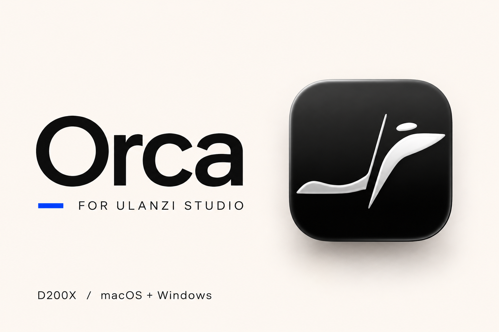

# Orca for Ulanzi Studio

[English](README.md) · [한국어](README.ko-KR.md) · [简体中文](README.zh-CN.md) · [日本語](README.ja-JP.md)

Ulanzi Creative Deck D200X의 버튼과 노브로 Orca를 조작하는 독립 제작 플러그인입니다. 발행자는 **AMOSA**이며 팀에서 공동 관리합니다. 버전 **0.0.1**은 Ulanzi 마켓 심사 중입니다.



## 기능

- Orca 열기, 이전·다음 워크트리, 이전·다음 탭(모든 유형)
- 좌·우 사이드바 표시/숨기기, 확인(Enter), 취소(Esc), 받아쓰기
- 새 에이전트 탭(macOS 전용)
- 워크트리 탐색·전체 탭 탐색·마우스 휠 노브
- 한국어·영어·중국어 간체·일본어 메뉴

Enter/Esc는 현재 포커스에 일반 키 입력을 전달합니다. Enter는 메시지를 보낼 수 있으며 요청 승인·거절을 자동 식별하지 않습니다. 휠은 마우스 포인터가 놓인 영역을 스크롤합니다.

## 지원 환경

| 항목 | 범위 |
|---|---|
| 기기 | Creative Deck D200X |
| OS | macOS (Apple Silicon), Windows 10 이상 |
| 확인한 환경 | macOS 27.0.1 / Orca 1.4.258 / Ulanzi Studio 3.4.8 / D200X |
| Windows | 초기 지원, 자동 모의 테스트 통과, 실기 미검증 |

Intel Mac의 마우스 휠은 지원하지 않습니다. Linux는 지원하지 않습니다. Windows에서는 동작 설정에 설치된 Orca CLI의 절대 경로(`index.js` 또는 `.exe`)를 지정해야 합니다. 재설정한 Orca 단축키는 자동으로 반영하지 않습니다.

## 설치

Ulanzi Studio와 Orca를 먼저 설치하세요. 로컬 설치 파일은 아래 빌드 명령으로 생성할 수 있습니다.

1. Studio에서 `dist/com.ulanzi.orcanavigation.ulanziPlugin.zip`을 설치합니다.
2. 기본 설정 → 프리셋 → 가져오기에서 `dist/Orca-D200X-macOS-0.0.1.ulanziDeckProfile`을 선택합니다. 프리셋은 별도 가져오기 방식입니다.
3. 필요하면 프리셋의 Orca 앱 연결을 직접 지정합니다.
4. 설치·업데이트 후 Ulanzi Studio를 완전히 종료하고 다시 실행합니다. 실행 중 파일만 교체하면 이전 코드가 남아 버튼에 경고가 표시될 수 있습니다.

프리셋은 macOS 기준 배치입니다. Windows의 새 에이전트 탭은 사용할 수 없습니다. [배치·가져오기 안내](presets/README.md)를 참고하세요.

## 개발

Node.js 20.12.2 이상, Python 3이 필요합니다.

```sh
npm ci --prefix com.ulanzi.orcanavigation.ulanziPlugin
npm test --prefix com.ulanzi.orcanavigation.ulanziPlugin
python3 tools/build-plugin.py
python3 tools/build-preset.py
```

생성 결과는 `dist/`에 저장하며 Git에 포함하지 않습니다. 소스·네이티브 헬퍼·의존성·프리셋 구조는 [개발 안내](docs/development.md)를 참고하세요.

Orca 및 Ulanzi의 공식 제품이 아닙니다. 앱 아이콘과 외부 의존성 고지는 [THIRD_PARTY_NOTICES.txt](com.ulanzi.orcanavigation.ulanziPlugin/THIRD_PARTY_NOTICES.txt)에 있습니다.

## 라이선스

AMOSA의 프로젝트 코드는 [MIT](LICENSE)로 배포합니다. Orca 아이콘과 외부 의존성에는 [별도 고지](com.ulanzi.orcanavigation.ulanziPlugin/THIRD_PARTY_NOTICES.txt)가 적용됩니다. 상표 권리는 각 소유자에게 있습니다.

## 프로젝트 관리

`main`은 공개 배포 기준, `dev`는 개발 브랜치입니다. 문제·개선 제안은 [Issues](https://github.com/AMOSA-DEV/orca-for-ulanzi/issues)에 남겨주세요. [Orca 공식 저장소](https://github.com/stablyai/orca)와 별개로 관리되는 커뮤니티 프로젝트입니다.
