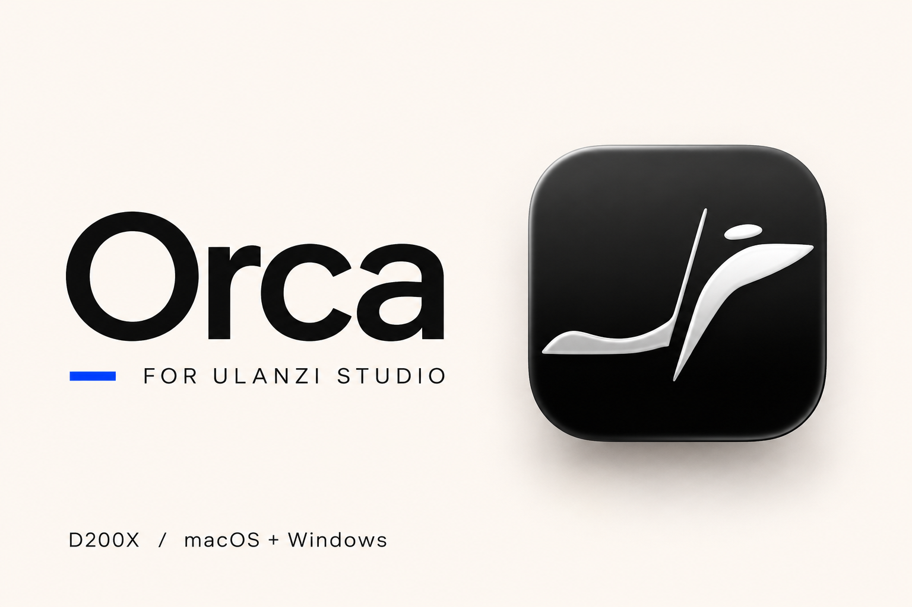

# Orca for Ulanzi Studio

[English](README.md) · [한국어](README.ko-KR.md) · [简体中文](README.zh-CN.md) · [日本語](README.ja-JP.md)

Independent plugin by **AMOSA** for controlling Orca with Ulanzi Creative Deck D200X keys and dials. Version **0.0.1** is under Ulanzi marketplace review.



## Features

- Launch Orca; previous/next worktree and tabs of every type
- Toggle both sidebars; Enter, Escape, dictation; new agent tab (needs an Orca shortcut on Windows)
- Worktree navigation, all-tab navigation and mouse-wheel dials
- English, Korean, Simplified Chinese and Japanese interface

Enter may send a message. Enter/Escape follow the current focus and do not identify approval requests. On macOS scrolling follows the mouse pointer; on Windows it follows the terminal that has keyboard focus. Split-pane navigation and closing the focused pane (pane dial, previous/next pane, close pane) are Windows-only because the macOS helper does not implement them; macOS users who want them are welcome to implement and contribute them.

## Compatibility

| Item | Support |
|---|---|
| Hardware | Creative Deck D200X |
| OS | macOS (Apple Silicon), Windows 10 or later |
| Tested setup | macOS 27.0.1 / Orca 1.4.258 / Ulanzi Studio 3.4.8 / D200X |
| Windows | Initial support; mocked tests pass; hardware testing pending |

Intel Mac mouse-wheel input and Linux are unsupported. On Windows, set the absolute path to the installed Orca CLI (`index.js` or `.exe`) in each action's settings. Custom Orca keybindings are not detected automatically. The new agent tab action is macOS-only.

## Installation

Install [Orca](https://github.com/stablyai/orca) and Ulanzi Studio first. Build the packages using the commands below.

1. Install `dist/com.ulanzi.orcanavigation.ulanziPlugin.zip` in Studio.
2. Import `dist/Orca-D200X-macOS-0.0.1.ulanziDeckProfile` through Preferences → Presets → Import. The profile is installed separately.
3. Set the profile's Orca app association manually if needed.
4. Fully quit and reopen Studio after installation or updates. Replacing files while Studio is running can leave old code loaded and cause warning icons.

The included profile uses a macOS layout. See the [layout and import guide](presets/README.md) (Korean).

## Development

Requires Node.js 20.12.2 or later and Python 3.

```sh
npm ci --prefix com.ulanzi.orcanavigation.ulanziPlugin
npm test --prefix com.ulanzi.orcanavigation.ulanziPlugin
python3 tools/build-plugin.py
python3 tools/build-preset.py
```

Generated packages go into `dist/`, which is excluded from Git. See the [development guide](docs/development.md) (Korean) for the native helper and package structure.

## License

AMOSA's project code is available under the [MIT License](LICENSE). The Orca icon and third-party dependencies retain their [separate notices](com.ulanzi.orcanavigation.ulanziPlugin/THIRD_PARTY_NOTICES.txt). Trademarks belong to their respective owners.

## Project maintenance

`main` is the public release baseline; `dev` is the development branch. Report bugs and suggestions in [Issues](https://github.com/AMOSA-DEV/orca-for-ulanzi/issues). This community project is maintained independently of [Orca](https://github.com/stablyai/orca) and is not an official Orca or Ulanzi product.

Contributions, translations and device testing are welcome. See the [contributor guide](CONTRIBUTING.md#english); open pull requests against `dev`.
