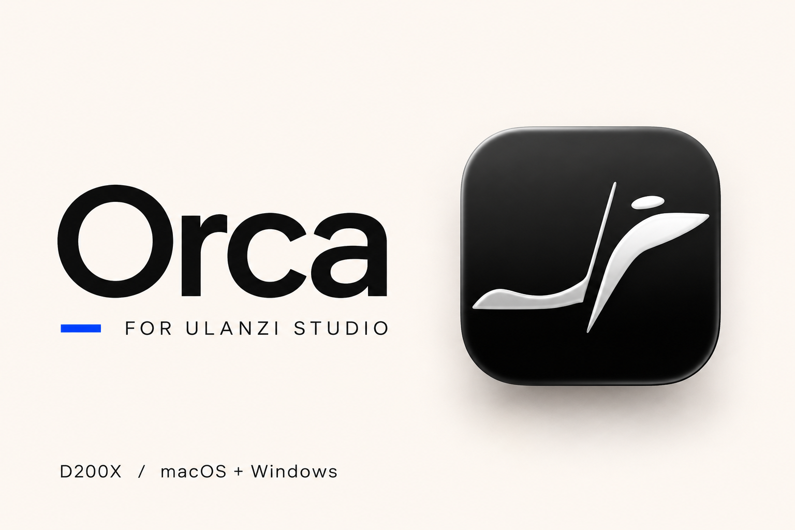

# Orca for Ulanzi Studio

[English](README.md) · [한국어](README.ko-KR.md) · [简体中文](README.zh-CN.md) · [日本語](README.ja-JP.md)

由 **AMOSA** 独立制作的 Ulanzi Creative Deck D200X 插件，通过按键和旋钮控制 Orca。版本 **0.0.1** 正在 Ulanzi 应用市场审核中。



## 功能

- 启动 Orca，切换上一个／下一个工作树和所有类型的标签页
- 切换左右侧边栏，Enter、Escape、听写，新建智能体标签页（仅 macOS）
- 工作树导航、所有标签页导航和鼠标滚轮旋钮
- 英语、韩语、简体中文和日语界面

Enter 可能发送消息。Enter／Escape 作用于当前焦点，不会自动识别批准请求。滚动作用于鼠标指针所在位置。

## 兼容性

| 项目 | 支持范围 |
|---|---|
| 设备 | Creative Deck D200X |
| 系统 | macOS（Apple Silicon）、Windows 10 及以上 |
| 已验证环境 | macOS 27.0.1 / Orca 1.4.258 / Ulanzi Studio 3.4.8 / D200X |
| Windows | 初步支持，模拟测试通过，尚未进行实机测试 |

不支持 Intel Mac 的鼠标滚轮及 Linux。Windows 用户需要在各动作设置中指定已安装的 Orca CLI 的绝对路径（`index.js` 或 `.exe`）。不会自动识别用户修改的 Orca 快捷键。新建智能体标签页仅支持 macOS。

## 安装

请先安装 [Orca](https://github.com/stablyai/orca) 和 Ulanzi Studio，并使用下方命令生成安装包。

1. 在 Studio 中安装 `dist/com.ulanzi.orcanavigation.ulanziPlugin.zip`。
2. 在「偏好设置 → 预设 → 导入」中选择 `dist/Orca-D200X-macOS-0.0.1.ulanziDeckProfile`。预设需要单独导入。
3. 如有需要，手动设置预设与 Orca 应用的关联。
4. 安装或更新后完全退出并重新打开 Studio。运行时替换文件可能导致旧代码继续运行，并显示警告图标。

附带预设采用 macOS 布局。请参阅[布局和导入说明](presets/README.md)（韩语）。

## 开发

需要 Node.js 20.12.2 及以上和 Python 3。

```sh
npm ci --prefix com.ulanzi.orcanavigation.ulanziPlugin
npm test --prefix com.ulanzi.orcanavigation.ulanziPlugin
python3 tools/build-plugin.py
python3 tools/build-preset.py
```

生成文件位于 `dist/`，不纳入 Git。原生辅助程序与目录结构见[开发说明](docs/development.md)（韩语）。

## 许可证

AMOSA 的项目代码采用 [MIT 许可证](LICENSE)。Orca 图标和第三方依赖保留其[单独声明](com.ulanzi.orcanavigation.ulanziPlugin/THIRD_PARTY_NOTICES.txt)。商标权归各自所有者所有。

## 项目维护

`main` 为公开发布基线，`dev` 为开发分支。问题和建议请提交至 [Issues](https://github.com/AMOSA-DEV/orca-for-ulanzi/issues)。本项目独立于 [Orca 官方项目](https://github.com/stablyai/orca)维护，非 Orca 或 Ulanzi 官方产品。

欢迎代码、翻译和实机测试贡献。请阅读[贡献指南](CONTRIBUTING.md#简体中文)，PR 目标分支设为 `dev`。
